# My Farm Advisor Skills

This repository is the My Farm Advisor skill catalog: three portable agent
skills that turn farm, field, trial, and genotype data into decisions —
analyses a peer could re-run, maps a scout could trust, plans a season could
execute. It contains the skills, their local instructions, examples, scripts,
and validation checks that make the workflows discoverable by agents and
readable by humans. The catalog is harness-neutral: any agent runtime that can
read `SKILL.md` / `AGENTS.md` files can use it.

| Skill | Scope | Start here |
| --- | --- | --- |
| 🌾 `my-farm-advisor` | Field management, soil, weather, imagery, terrain, EDA, strategy, admin maps, farm-data pipelines and reporting | [`SKILL.md`](my-farm-advisor/SKILL.md) |
| 🌱 `my-farm-breeding-trial-management` | Trial design, fieldbooks, germplasm, selection, crossing, field-boundary-aware trial placement | [`SKILL.md`](my-farm-breeding-trial-management/SKILL.md) |
| 🧬 `my-farm-qtl-analysis` | GWAS, eQTL, classical QTL, VCF/SNP QC, population structure, genomic prediction, genetics reporting | [`SKILL.md`](my-farm-qtl-analysis/SKILL.md) |

## What the output looks like

Every figure below was rendered by a script in this repository from public,
keyless data sources (verification fixtures; regenerate them with the
commands in each example's README).

### Farm data stacks — terrain, soil, and crop type for one field boundary

Rendered by [`render_field_maps.py`](my-farm-advisor/data-pipeline/src/scripts/render_field_maps.py)
from a demo grower's runtime data: Copernicus DEM hillshade, national soil
surveys, and per-year WorldCereal crop inference, co-registered to the field
boundary (red).

| Iowa, US — 172 ha | Ontario, CA — 593 ha | Narrabri, AU — 1,233 ha |
| --- | --- | --- |
| 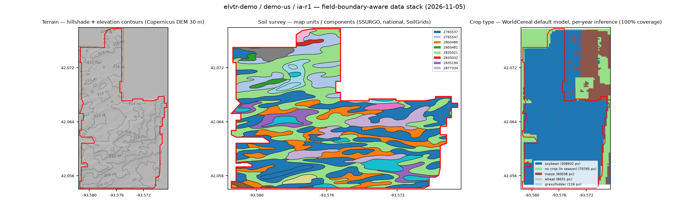 | 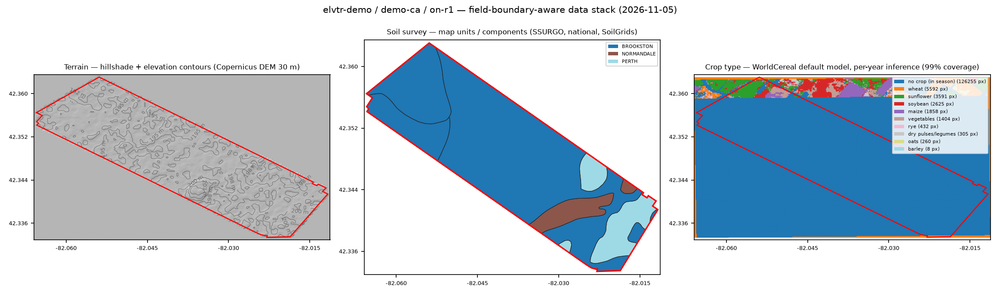 | 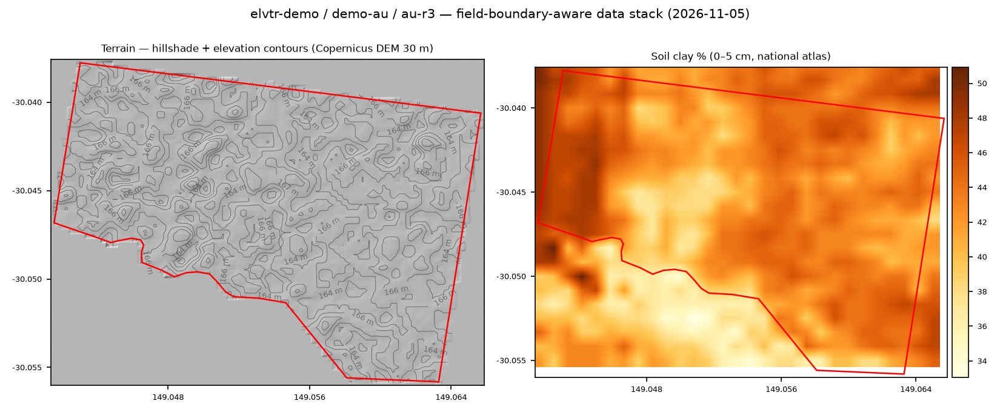 |
| SSURGO map units; terrain auto-resolved to USGS 3DEP **1 m LiDAR**; WorldCereal independently called **soybean** on a documented 2023 soy field | Ontario soil survey components (Brookston/Perth/Normandale); winter-window inference | Soil Atlas of Australia clay % (SLGA/ASF); terrain panel from the global 30 m DEM |

### Per-year crop classification anywhere — keyless satellite imagery

Rendered by [`render_worldcereal.py`](my-farm-advisor/data-pipeline/src/scripts/render_worldcereal.py)
using the open WorldCereal default models on Microsoft Planetary Computer
Sentinel-2 (no accounts, no keys).

| Iowa soy verification | Narrabri, dry season | Narrabri, summer season |
| --- | --- | --- |
| 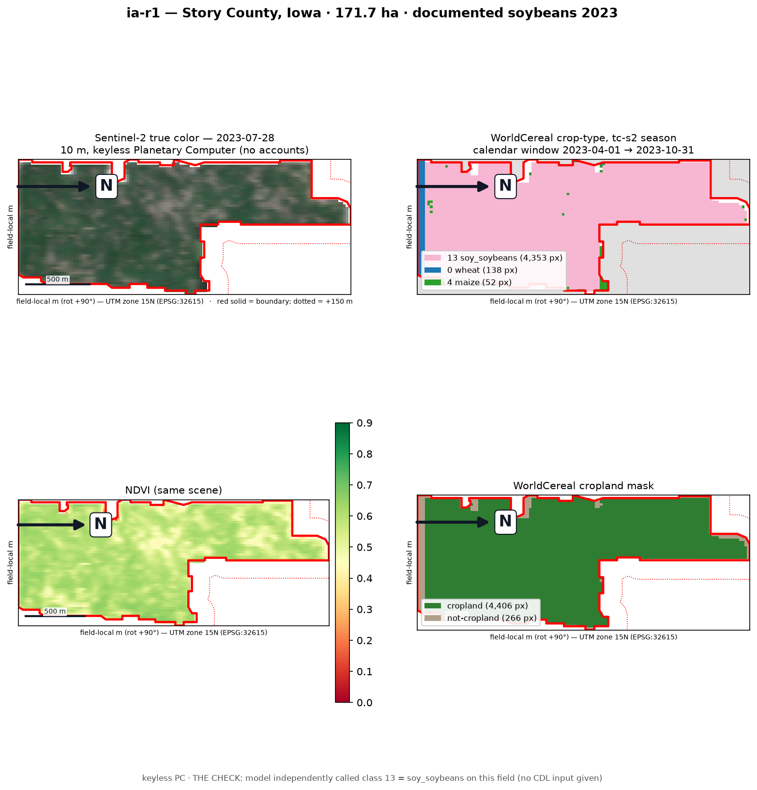 | 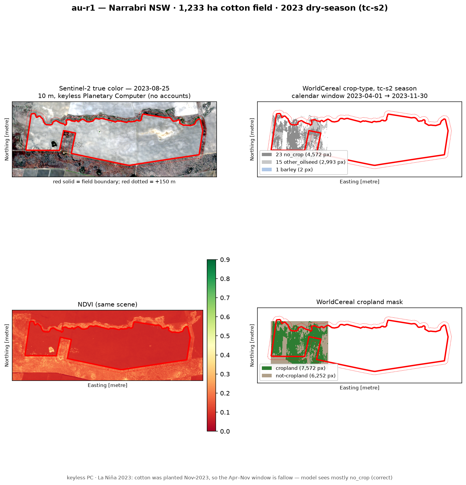 | 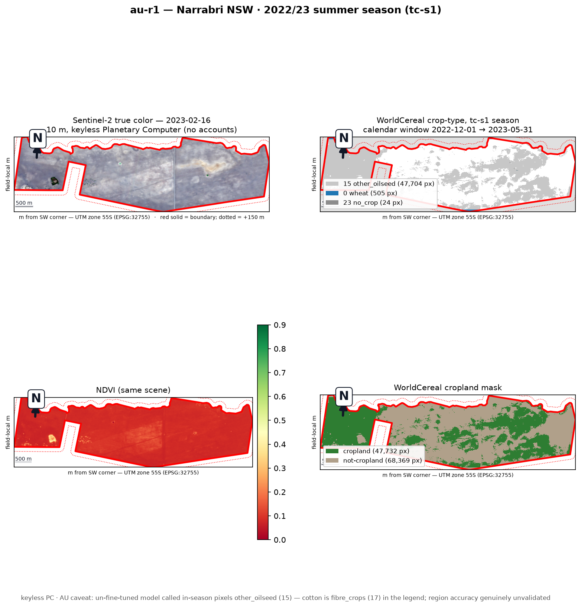 |
| True color, NDVI, cropland mask, crop type — model called soybean with no label input | Correctly sees the fallow dry-season window (La Niña 2023) | Honest caveat: un-fine-tuned model mislabels cotton as oilseed — regional accuracy stated, not oversold |

### Breeding operations — designs, fieldbooks, and selection

| Alpha-lattice design | Field-book plot map | Genomic breeding values |
| --- | --- | --- |
| 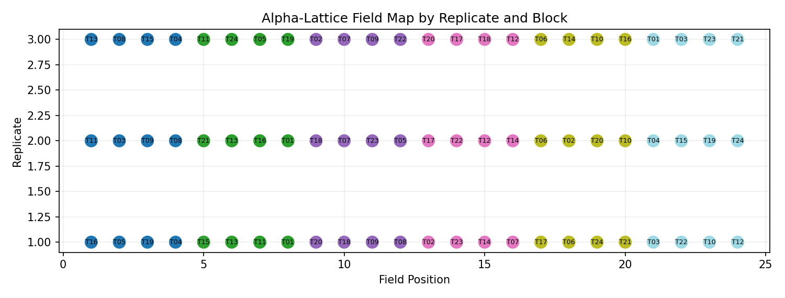 | 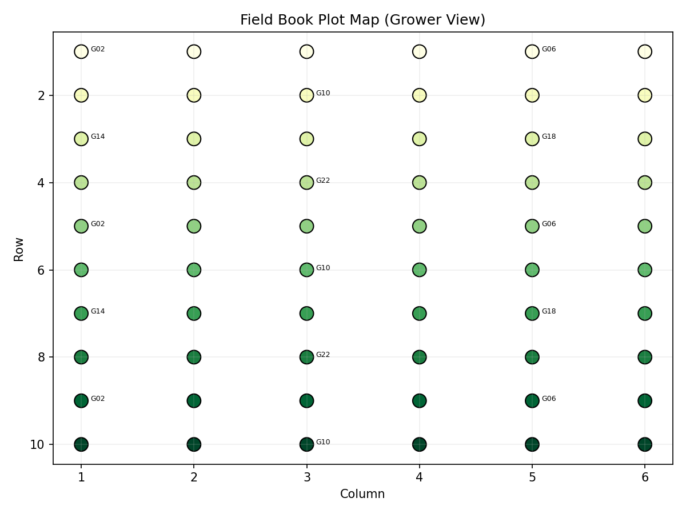 | 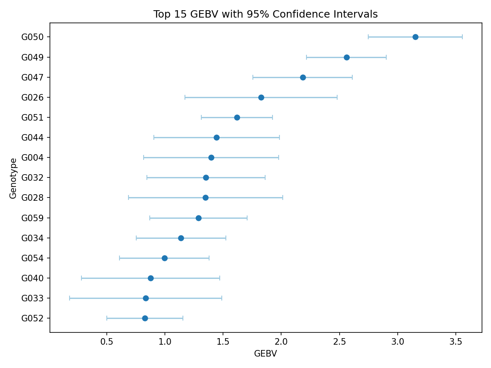 |
| 24 treatments × 3 reps, blocks of 4, randomized per replicate | Grower-view plot layout straight from a generated fieldbook | Top-15 genotypes with 95 % CIs after BLUP |

### Quantitative genetics — mapping and diagnostics

| QTL ideogram + aligned Manhattan | Genomic-control QQ |
| --- | --- |
| 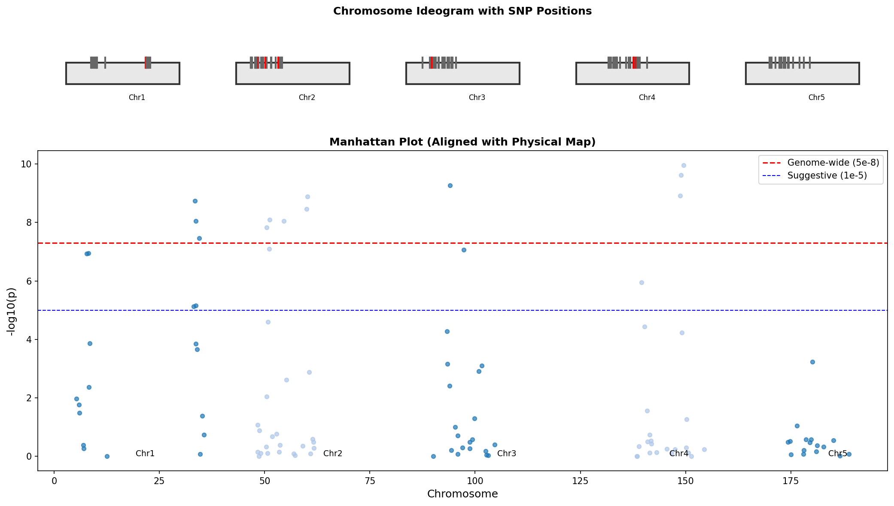 | 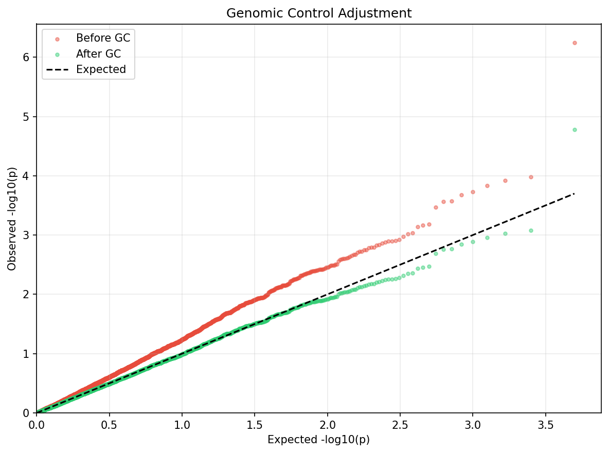 |
| Significant QTL flagged per chromosome, thresholds documented | Inflation before correction, realigned after — the QC story in one panel |

## Global data coverage — the best available data for your location

"Global" here does not mean one flattened global layer everywhere. It means a
**ladder**: the highest-resolution authoritative source that covers the field's
country, with a verified global wall underneath so *no location ever falls
through*. Ingest scripts pick the top of the ladder automatically (the terrain
resolver ranks adapters by measured resolution and provenance and warns above
its 30 m coarseness threshold), and every run records which source won. No API
keys, logins, or paid services anywhere in the default path.

| Capability | Regional / national tier (best available) | Global floor (always works) |
| --- | --- | --- |
| **Terrain** | USGS The National Map — 3DEP DEM at 1 m / 1/9° / 1/3° / 2 m / 10 m where mapped (US); ILHMP LiDAR (Illinois, sub-metre) | Copernicus DEM GLO-30 (COG), NASADEM 1″, ALOS AW3D30 — resolution-ranked auto-selection with full derivative suite (slope, aspect, hillshade, D8 flow, contours) |
| **Field boundaries** | USDA Crop Sequence Boundaries (US, field-level polygons every year) | OSM/Overpass farm rules (CA, AU, anywhere) + new-country checklist in [`field-boundary-sources.md`](my-farm-advisor/data-pipeline/references/field-boundary-sources.md) |
| **Soil** | SSURGO (US, tested/method flags); Ontario detailed soil survey (CA); Soil Atlas of Australia via Gaia-DAP (AU) | SoilGrids 250 m with verified scale table; country-aware routing in [`soil-routing.md`](my-farm-advisor/soil/soil-routing.md) |
| **Crop rotation history** | USDA CDL, 2008→ (US); AAFC ACI, 2017→ (CA) | Per-year WorldCereal default-model inference on keyless Sentinel-2 (any country) — see below |
| **Imagery** | Landsat 5–9 + Sentinel-2 harmonized archives (all 2000+ countries, 30 m / 10 m) via Planetary Computer STAC | Same archive — this tier *is* global; Sentinel-1 currently NODATA on the keyless path |
| **Weather** | NASA POWER field-centroid Zarr (station-assimilated, any coordinate) | Same |
| **Admin & context** | geoadmin + combined FIPS (US); corn RM / soybean MG zones (US + CA) | GADM L1/L2, choropleth maps |

**Rotation history for any country, any year.** Where no national map exists,
[`apply_worldcereal.py`](my-farm-advisor/data-pipeline/src/scripts/ingest/apply_worldcereal.py)
runs the open [WorldCereal default models](https://github.com/WorldCereal/worldcereal-classification)
(MIT) per year on Planetary Computer Sentinel-2 — zero accounts, 12 monthly
composites from the crop-calendar season window (Southern-Hemisphere cross-year
correct), provenance + honest regional-accuracy caveats with every output. The
routing order and the fine-tuning upgrade path are in
[`crop-rotation-sources.md`](my-farm-advisor/data-pipeline/references/crop-rotation-sources.md).
Capability matrix details in
[`my-farm-advisor/README.md`](my-farm-advisor/README.md#global-data-coverage-any-country-zero-accounts).

## How the catalog is organized

Three skills, each a routed family of workflow areas. The router stays small;
the knowledge lives close to the work.

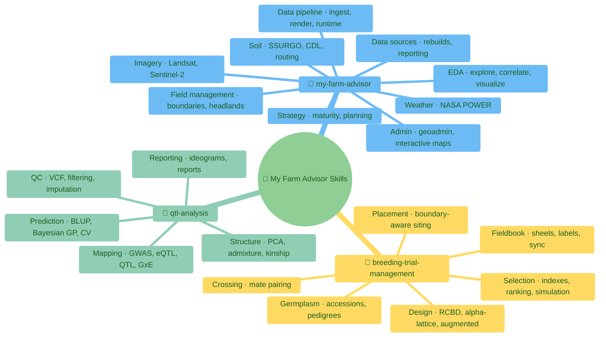

## How a request flows

The routing hierarchy is a contract: `SKILL.md` → `INDEX.md` → subtree
`AGENTS.md` → matching guide/script/example. Never skip levels.

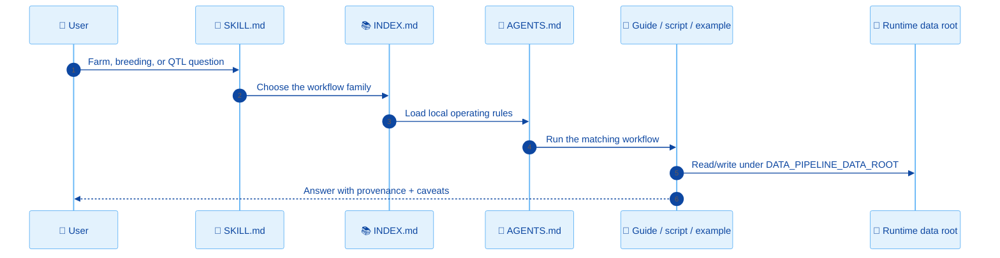

## How data-source routing decides

Country-aware tiering (soil shown; the same ladder governs boundaries and
rotation history, documented in `soil/soil-routing.md`):


## Runtime and output rules

| Rule | Why |
| --- | --- |
| Runtime data lives outside Git, under `${DATA_PIPELINE_DATA_ROOT}` (default `./data`) | Farm data grows roughly linearly with monitored acreage — the clone must stay small for any deployment |
| Generated outputs are committed at exactly one place: `examples/**/output/*.png` | Small deterministic fixtures let examples verify offline; everywhere else, regenerate at runtime (see [`ASSET_POLICY.md`](ASSET_POLICY.md)) |
| Pinned URLs + sha256 journals for downloads | Checksum drift fails closed; a run is reproducible months later |
| Commit metadata and source records, not payloads | Provenance without repository bloat |
| Run `./scripts/validate.sh` after structural changes | Catches missing routers, stale links, and policy regressions |

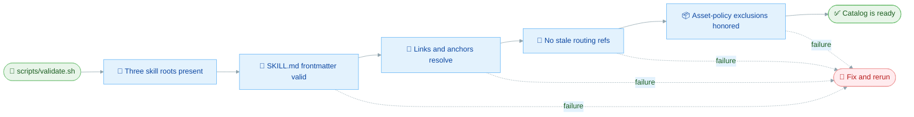

## The three skills in detail

### 🌾 My Farm Advisor

| Area | Index | Examples of work |
| --- | --- | --- |
| Admin | [`admin/INDEX.md`](my-farm-advisor/admin/INDEX.md) | Geoadmin workflows and interactive maps |
| Data sources | [`data-sources/INDEX.md`](my-farm-advisor/data-sources/INDEX.md) | Data rebuilds, deterministic pipeline runs, intelligence reporting |
| EDA | [`eda/INDEX.md`](my-farm-advisor/eda/INDEX.md) | Exploration, comparisons, correlations, visualization, time series |
| Field management | [`field-management/INDEX.md`](my-farm-advisor/field-management/INDEX.md) | Boundaries, CSB sampling, headlands |
| Imagery | [`imagery/INDEX.md`](my-farm-advisor/imagery/INDEX.md) | Landsat and Sentinel-2 workflows |
| Soil | [`soil/INDEX.md`](my-farm-advisor/soil/INDEX.md) | SSURGO, CDL, country routing, poster cards |
| Strategy | [`strategy/INDEX.md`](my-farm-advisor/strategy/INDEX.md) | Crop strategy and maturity planning |
| Weather | [`weather/INDEX.md`](my-farm-advisor/weather/INDEX.md) | NASA POWER weather and derived analysis |
| Data pipeline | [`data-pipeline/README.md`](my-farm-advisor/data-pipeline/README.md) | Country-aware ingest, per-field rendering, runtime management |

### 🌱 My Farm Breeding Trial Management

| Area | Examples of work |
| --- | --- |
| Design | RCBD, alpha-lattice, augmented designs (with committed layout fixtures) |
| Fieldbook | Plot sheets, labels, imports, IoT field sync |
| Placement | Field-boundary-aware trial siting |
| Germplasm | Accessions, pedigrees, mock breeding-system integrations |
| Selection | Selection indexes, GEBV ranking, cycle simulation |
| Crossing | Mate pairing, coancestry-aware crossing plans |

### 🧬 My Farm QTL Analysis

| Area | Examples of work |
| --- | --- |
| Mapping | GWAS (GLM/LMM), eQTL, classical QTL, GxE, covariates, rare variants |
| QC | VCF validation, SNP filtering, genomic control, imputation |
| Structure | PCA, admixture, LD decay, haplotypes, kinship |
| Prediction | Genomic prediction, BLUP, Bayesian GP, elastic net, cross-validation |
| Reporting | Ideograms, analysis reports, real-dataset packaging |

## Repository layout

```text
my-farm-advisor-skills/
├── README.md, AGENTS.md, ASSET_POLICY.md
├── scripts/validate.sh
├── my-farm-advisor/                 # SKILL.md, INDEX.md, AGENTS.md, workflow areas,
│                                    # data-pipeline (ingest scripts + example fixtures)
├── my-farm-breeding-trial-management/
└── my-farm-qtl-analysis/
```

## Working in this repo

| Task | Start here | Validate with |
| --- | --- | --- |
| Route a farm advisory request | [`my-farm-advisor/SKILL.md`](my-farm-advisor/SKILL.md) | `./scripts/validate.sh` |
| Route a breeding request | [`my-farm-breeding-trial-management/SKILL.md`](my-farm-breeding-trial-management/SKILL.md) | `./scripts/validate.sh` |
| Route a QTL request | [`my-farm-qtl-analysis/SKILL.md`](my-farm-qtl-analysis/SKILL.md) | `./scripts/validate.sh` |
| Add/refresh an example figure | The example's own README | Render, inspect, commit to `examples/**/output/` |
| Change catalog structure | Root [`AGENTS.md`](AGENTS.md) | `bash -n scripts/validate.sh && ./scripts/validate.sh` |

Keep edits focused, keep operational data in the runtime root, and route
through the nearest `INDEX.md` before opening detailed workflow docs.
