# My Farm Advisor Skills

This repository is the My Farm Advisor skill catalog: three portable agent
skills that turn farm, field, trial, and genotype data into decisions —
analyses a peer could re-run, maps a scout could trust, plans a season could
execute. It contains the skills, their local instructions, examples, scripts,
and validation checks that make the workflows discoverable by agents and
readable by humans. The catalog is harness-neutral: any agent runtime that can
read `SKILL.md` / `AGENTS.md` files can use it.

| Skill | Status | Scope | Start here |
| --- | --- | --- | --- |
| 🌾 `my-farm-advisor` | **Active focus** | Field management, soil, weather, imagery, terrain, EDA, strategy, admin maps, farm-data pipelines and reporting | [`SKILL.md`](my-farm-advisor/SKILL.md) |
| 🌱 `my-farm-breeding-trial-management` | Initial stab — expanding | Trial design, fieldbooks, germplasm, selection, crossing, field-boundary-aware trial placement | [`SKILL.md`](my-farm-breeding-trial-management/SKILL.md) |
| 🧬 `my-farm-qtl-analysis` | Initial stab — expanding | GWAS, eQTL, classical QTL, VCF/SNP QC, population structure, genomic prediction, genetics reporting | [`SKILL.md`](my-farm-qtl-analysis/SKILL.md) |

**Why this ordering is deliberate:** the data pipeline is the keystone — you
need trustworthy field data before trial analytics or genotype-by-phenotype
analysis can say anything. The advisor skill and its pipelines get built out
first so the breeding and QTL skills can grow into that foundation later with
more power behind them. Expect the 🌱 and 🧬 trees to expand the most over the
coming releases; their current examples are real and runnable, just fewer than
what's coming.

## What the output looks like

Every figure below was rendered by a script in this repository from public,
keyless data sources (verification fixtures; regenerate them with the
commands in each example's README).

### The images are the demo; the raw data is the product

**Download once, keep forever.** Everything you see rendered below is a thin
matplotlib drawing over a private, growing local archive: GeoTIFFs (terrain,
soil rasters, per-year crop classification, imagery), parquet tables (weather,
admin lookups, maturity grids), and GeoJSON polygons (boundaries, soil survey
map units) — one folder tree per field under `$DATA_PIPELINE_DATA_ROOT`. The
figures are the *simple* presentation format so examples can be committed and
verified offline; they are emphatically not the final form. Your agent knows
where every raw artifact lives, what produced it, and how to traverse the tree
(manifests and provenance JSON sit next to every output), so your actual
deliverable — a web map, a dashboard, an app, a slide, a scouting tool — reads
those same sources and draws them the way *you* need. The pipeline's unit of
value is the durable raw layer, not the PNG.

### Ready-to-use layers, not downloads you still have to process

The ingest scripts don't stop at "here's your raster." Take terrain: one call
clips the best-resolution DEM to your boundary, hydrologically conditions it,
and emits the **full derivative stack as GeoTIFFs with previews** — slope
(degrees and percent), aspect, hillshade, D8 flow direction and accumulation,
profile and planform curvature, topographic wetness index, TPI, TRI, relative
elevation, depression depth, and an erosion proxy — plus per-field summary
tables. Every layer carries the same provenance record, so a drainage or
erosion conversation downstream starts from computed rasters, not a raw DEM
and a to-do list. Same pattern across the archive: soil comes as rasters *and*
survey polygons with attribute tables, weather as daily-parquet plus computed
GDD, crop classification as per-year class grids *and* per-class probability
bands. It's a ready-to-use data pipeline for any purpose here — the processing
is the product; the download is just step one.

### Farm data stacks — terrain, soil, and crop type for one field boundary

Rendered by [`render_field_maps.py`](my-farm-advisor/data-pipeline/src/scripts/render_field_maps.py)
from a demo grower's runtime data: Copernicus DEM hillshade, national soil
surveys, and per-year WorldCereal crop inference, co-registered to the field
boundary (red).

| Iowa, US — 172 ha | Ontario, CA — 593 ha | Namoi Valley, AU — 44 ha pivot |
| --- | --- | --- |
|  |  | 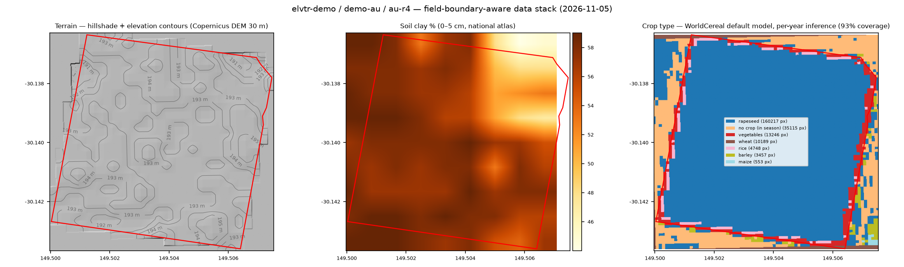 |
| SSURGO map units; terrain auto-resolved to USGS 3DEP **1 m LiDAR**; WorldCereal independently called **soybean** on a documented 2023 soy field | Ontario soil survey components (Brookston/Perth/Normandale); winter-window inference | Soil Atlas of Australia clay % (SLGA/ASF, real values); WorldCereal called **rapeseed on 93 %** of this irrigated pivot — near-complete field coverage at 384 px |

### Soil intelligence at three resolution tiers

Same renderer, three provenance levels — survey polygons where they exist,
national atlases where they do, and the global 250 m floor everywhere:

| US — SSURGO survey polygons | Canada — SoilGrids global floor | Australia — national Soil Atlas |
| --- | --- | --- |
| 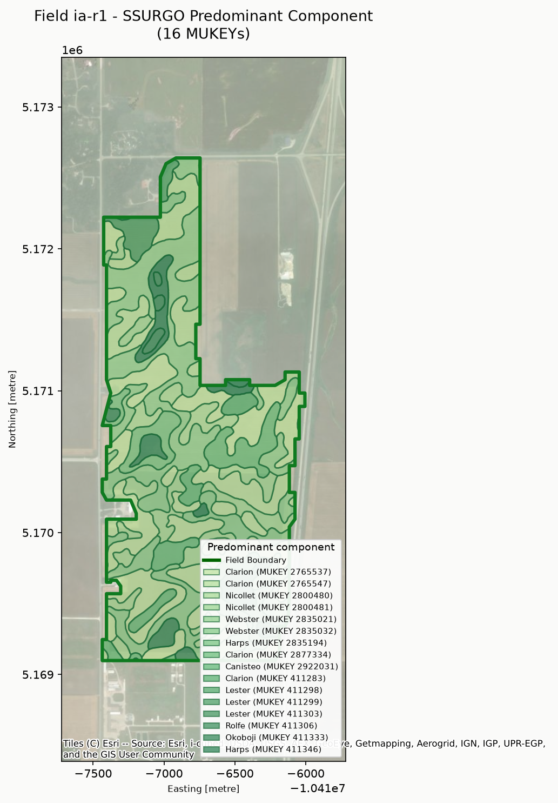 | 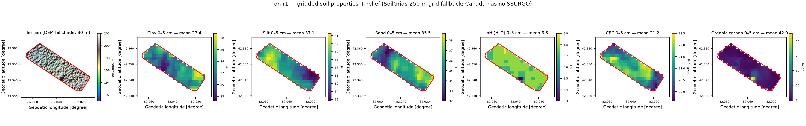 | 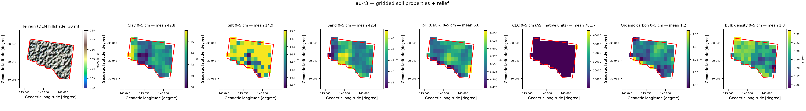 |
| 16 mapped soil components inside one boundary — names, MUKEYs, horizon tables behind every color | 7 properties + relief, field-mean annotated per panel (pH 6.8, CEC 21.2 cmol/kg) | vertisol reality check: 42.8 % clay at 0–5 cm, pH 6.6; unscaled bands labeled honestly as native units |

### Derived planning layers — computed from our own weather, not licensed

| Corn relative maturity (model-derived) | Soybean MG (model-derived) |
| --- | --- |
| 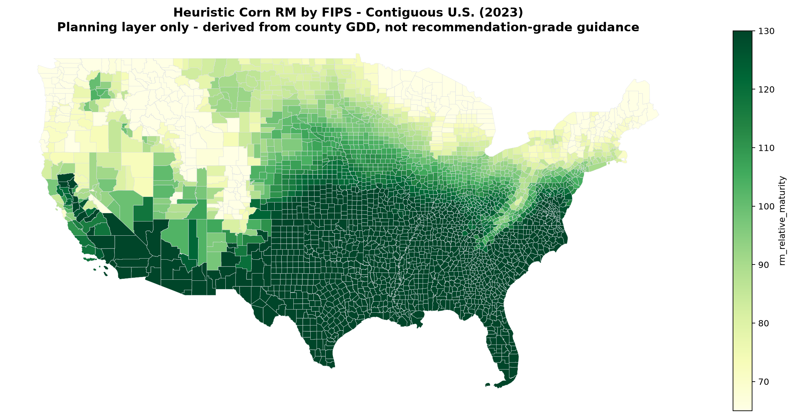 | 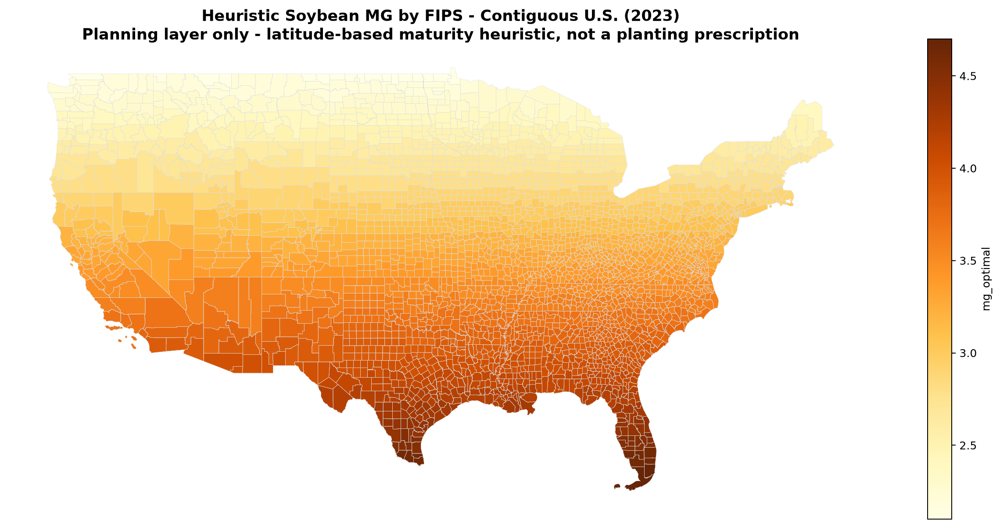 |
| County GDD from our POWER pipeline → RM surface; recomputed per year; subtitle states its own limits | Latitude + heat-unit heuristic; planning layer, not a prescription — the caption says so |

### One page per field, and weather you can audit

| Full-season field report | GDD accumulation (derived) | Year-over-year precipitation |
| --- | --- | --- |
| 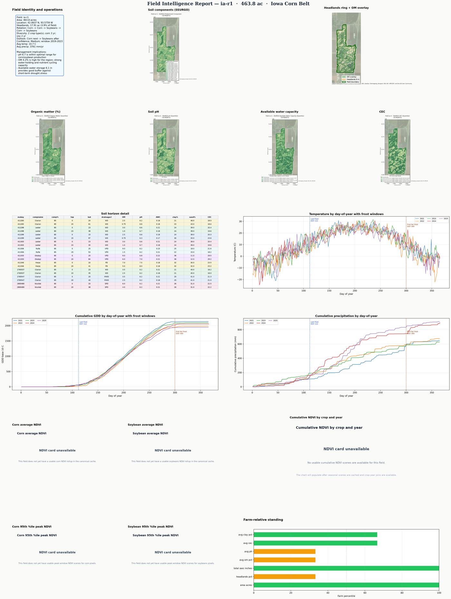 | 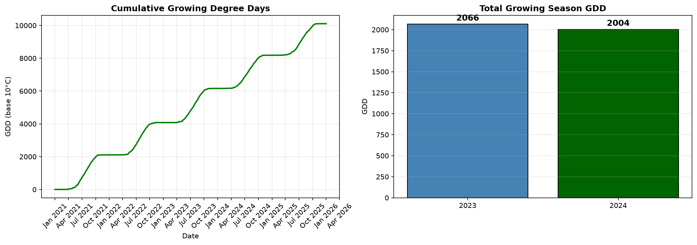 | 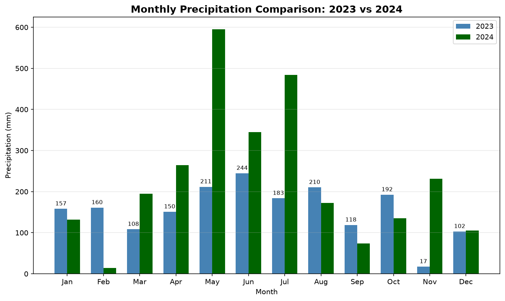 |
| Identity, rotation history, soil horizons, frost windows, five-season curves — every number traceable to its cached source layer | Cumulative + per-season GDD base-10 from raw daily weather | Every point recomputable from the daily parquet |

### Per-year crop classification anywhere — keyless satellite imagery

Rendered by [`render_worldcereal.py`](my-farm-advisor/data-pipeline/src/scripts/render_worldcereal.py)
using the open WorldCereal default models on Microsoft Planetary Computer
Sentinel-2 (no accounts, no keys).

| Iowa soy verification | Narrabri, dry season | Narrabri, summer season |
| --- | --- | --- |
|  |  |  |
| True color, NDVI, cropland mask, crop type — model called soybean with no label input | Correctly sees the fallow dry-season window (La Niña 2023) | Honest caveat: un-fine-tuned model mislabels cotton as oilseed — regional accuracy stated, not oversold |

### Breeding operations — designs, fieldbooks, and selection

| Boundary-aware trial placement | Alpha-lattice design | Genomic breeding values |
| --- | --- | --- |
| 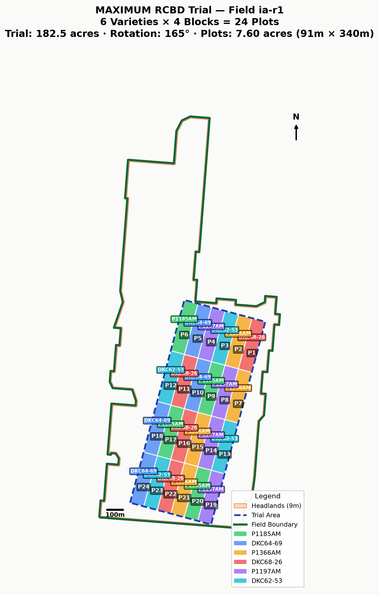 |  |  |
| Maximized 6-var × 4-block RCBD rotated into one lobe of an irregular field, 9 m headlands respected — trial geometry planned against the real boundary | 24 treatments × 3 reps, blocks of 4, randomized per replicate | Top-15 genotypes with 95 % CIs after BLUP |

### Quantitative genetics — mapping and diagnostics

| QTL ideogram + aligned Manhattan | Genomic-control QQ | Pedigree relationship matrix |
| --- | --- | --- |
|  |  | 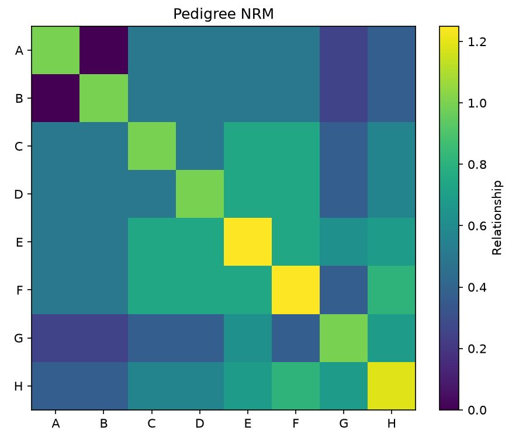 |
| Significant QTL flagged per chromosome, thresholds documented | Inflation before correction, realigned after — the QC story in one panel | Inbreeding visible on the diagonal; relatedness blocks from a demo pedigree |

## Global data coverage — the best available data for your location

"Global" here does not mean one flattened global layer everywhere. It means a
**ladder**: the highest-resolution authoritative source that covers the field's
country, with a verified global wall underneath so *no location ever falls
through*. Ingest scripts pick the top of the ladder automatically (the terrain
resolver ranks adapters by measured resolution and provenance and warns above
its 30 m coarseness threshold), and every run records which source won. No API
keys, logins, or paid services anywhere in the default path.

| Capability | Regional / national tier (best available) | Global floor (always works) |
| --- | --- | --- |
| **Terrain** | USGS The National Map — 3DEP DEM at 1 m / 1/9° / 1/3° / 2 m / 10 m where mapped (US); ILHMP LiDAR (Illinois, sub-metre) | Copernicus DEM GLO-30 (COG), NASADEM 1″, ALOS AW3D30 — resolution-ranked auto-selection with full derivative suite (slope, aspect, hillshade, D8 flow, contours) |
| **Field boundaries** | USDA Crop Sequence Boundaries (US, field-level polygons every year) | OSM/Overpass farm rules (CA, AU, anywhere) + new-country checklist in [`field-boundary-sources.md`](my-farm-advisor/data-pipeline/references/field-boundary-sources.md) |
| **Soil** | SSURGO (US, tested/method flags); Ontario detailed soil survey (CA); Soil Atlas of Australia via Gaia-DAP (AU) | SoilGrids 250 m with verified scale table; country-aware routing in [`soil-routing.md`](my-farm-advisor/soil/soil-routing.md) |
| **Crop rotation history** | USDA CDL, 2008→ (US); AAFC ACI, 2017→ (CA) | Per-year WorldCereal default-model inference on keyless Sentinel-2 (any country) — see below |
| **Imagery** | Sentinel-2 L2A (10 m, ~5-day revisit) + Landsat Collection 2 L2 (30 m; collection back to 1982 — pipeline defaults to Landsat 8+9 for the combined 8-day window) | Same archives are global via keyless Planetary Computer STAC; Sentinel-1 C-band SAR (VV/VH) is wired into the WorldCereal input cube — real radar via the free optional CDSE backend, constant NODATA in the keyless default (documented trade-off) |
| **Weather** | NASA POWER field-centroid Zarr (station-assimilated, any coordinate) | Same |
| **Admin & context** | geoadmin + combined FIPS (US) | L0 every country (Natural Earth); L1/L2 **any** ISO3 via `--gadm-iso` (GADM 4.1, one-key-free download, merged into the same combined lookup) |
| **Maturity zones (derived, not licensed)** | Corn RM / soybean MG computed **in-house per year** for US FIPS counties + provincial analog (CA) | No open official source exists — every seed company keeps proprietary maps; we rebuild ours from literature-based heat-unit models driven by our own NASA POWER weather (default 2021–2025 window, annual parquets you can re-run). More crops and regions are on the roadmap |

**Rotation history for any country, any year.** Where no national map exists,
[`apply_worldcereal.py`](my-farm-advisor/data-pipeline/src/scripts/ingest/apply_worldcereal.py)
runs the open [WorldCereal default models](https://github.com/WorldCereal/worldcereal-classification)
(MIT) per year on Planetary Computer Sentinel-2 — zero accounts, 12 monthly
composites from the crop-calendar season window (Southern-Hemisphere cross-year
correct), provenance + honest regional-accuracy caveats with every output. The
routing order and the fine-tuning upgrade path are in
[`crop-rotation-sources.md`](my-farm-advisor/data-pipeline/references/crop-rotation-sources.md).
Capability matrix details in
[`my-farm-advisor/README.md`](my-farm-advisor/README.md#global-data-coverage-any-country-zero-accounts).

### Regional elevation extras beyond the global floor

The terrain tier is where "best available for your location" matters most,
because the gap between sources is 30 m vs sub-metre. The resolver registry
takes regional adapters the same way the boundary playbook takes new countries
— one module, provenance, license check — so extras are additive, never
forking:

| Status | Country | Better-than-global source |
| --- | --- | --- |
| ✅ Wired | US | USGS 3DEP (1 m / 1/9° / 1/3° / 2 m / 10 m, auto-resolved per field) |
| ✅ Wired | Illinois | ILHMP LiDAR (sub-metre) |
| 🔜 Next | Canada | NRCan **CanElevation** series: HRDEM/HRDEM Mosaic 10 m LiDAR-derived (186,000+ km² released), CCO 10 m, and open-licensed point clouds — Open Government Licence (Canada), attribution-required, account-free |
| 🔜 Next | Australia | **ELVIS** (Geoscience Australia's free national elevation portal: state LiDAR + DEMs under ICSM), Vicmap 10 m + LiDAR DEM collections (Victoria), GA SRTM 1″ national DEM-H/DEM-S |
| 📋 Catalogued | Europe / Japan / NZ | UK Environment Agency LiDAR (2/5 m), Netherlands AHN, Japan GSI 5 m, NZ LINZ — mostly open national programs; onboarding follows the same adapter checklist |

Wiring a national source changes nothing downstream: same contract, same
derivatives, and the resolver's provenance record shows which source won for
each field (e.g. the Iowa demo field resolves to USGS **1 m** with NASADEM and
ALOS 30 m logged as ranked alternatives).

## How the catalog is organized

Three skills, each a routed family of workflow areas. The router stays small;
the knowledge lives close to the work.

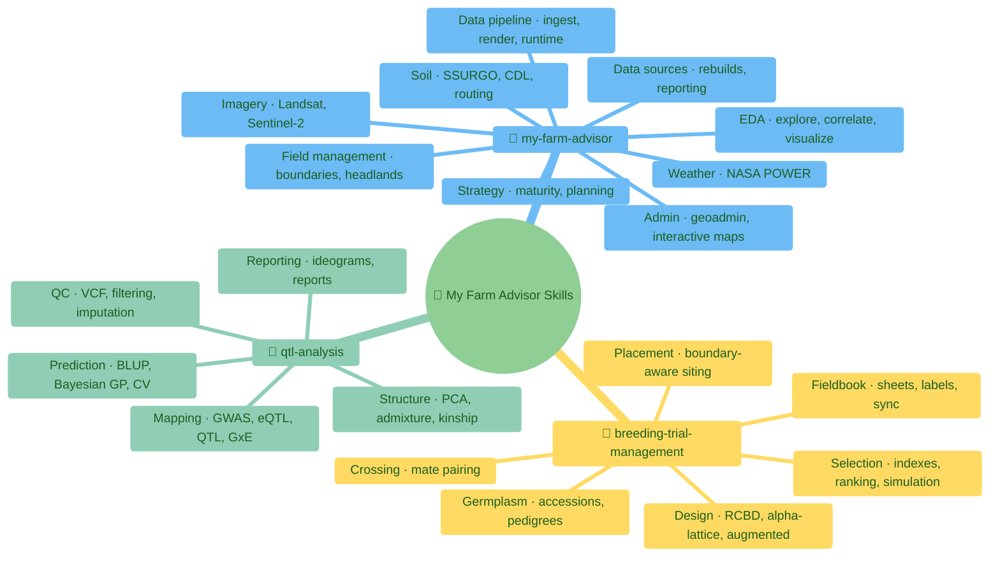

## How a request flows

The routing hierarchy is a contract: `SKILL.md` → `INDEX.md` → subtree
`AGENTS.md` → matching guide/script/example. Never skip levels.

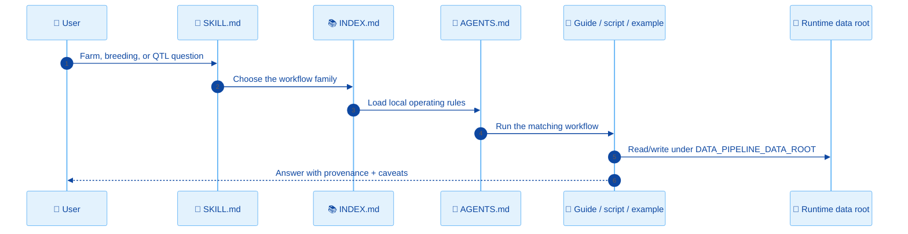

## Progressive disclosure — why the catalog is split this way

A large skill tree can quietly destroy an agent: if everything loads into the
prompt, a 656-file / 18 MB catalog becomes context-window tax on every session,
and the model drowns in instructions it doesn't need. This repo is structured
the opposite way — **only the routing surface is resident; knowledge loads on
demand as the request earns it**:

| Level | Files | Size in this catalog | When it enters context |
| --- | --- | --- | --- |
| L0 — discovery | `SKILL.md` frontmatter (name + trigger description) | a few lines each | always; it's what the harness matches the request against |
| L1 — router | 4 × `SKILL.md` bodies | 13.7 KB total | when a request matches a skill |
| L2 — family map | 13 × `INDEX.md` | 12.8 KB total | after routing picks the workflow family |
| L3 — operating rules | 29 × subtree `AGENTS.md` | 47.3 KB total | only for the subtree being edited or run |
| L4 — depth | 200+ guides, scripts, examples (≈750 KB of docs) | ~97 % of all bytes | only the one or two files the task actually needs |

A typical Ontario soil question touches roughly **3–8 KB of instructions** —
the SKILL.md router line, the soil INDEX row, the soil-subtree AGENTS.md, and
`soil-routing.md` — while the GWAS, breeding-design, and imagery manuals stay
on disk costing nothing. Routing itself is automatic: the L0 descriptions are
written as triggers ("use when…"), the L1/L2 tables map intents to files, and
the validator fails the build if any of those links rot, so an agent can trust
the ladder instead of reading the whole tree to find things.

**Harness portability.** Every level is a Markdown file with a stable name, and
nothing above L0 assumes a particular agent framework. **Hermes and OpenCode
are the first-class, continuously tested harnesses**; OpenClaw (this catalog's
birthplace), Pi, Claude-style skill runtimes, and Codex should work through the
same plain-file contract, and plain `grep` always does.

**Frontier models are not required.** The progressive-disclosure design exists
so that modest models can drive big workflows: the router files are small, the
scripts are deterministic, and provenance is in the data rather than in the
model's head. A lot of this catalog was built and is tested daily against
inexpensive models — Qwen 3.8 Flash Next and DeepSeek 4.1 Flash, including
locally served — and it began life on frontier GPT/Claude models back when the
cheap options couldn't hold a multi-step pipeline. They can now; the ecosystem
is moving fast, and this catalog is written to ride that curve rather than pay
a token tax to it.

## How data-source routing decides

Country-aware tiering (soil shown; the same ladder governs boundaries and
rotation history, documented in `soil/soil-routing.md`):

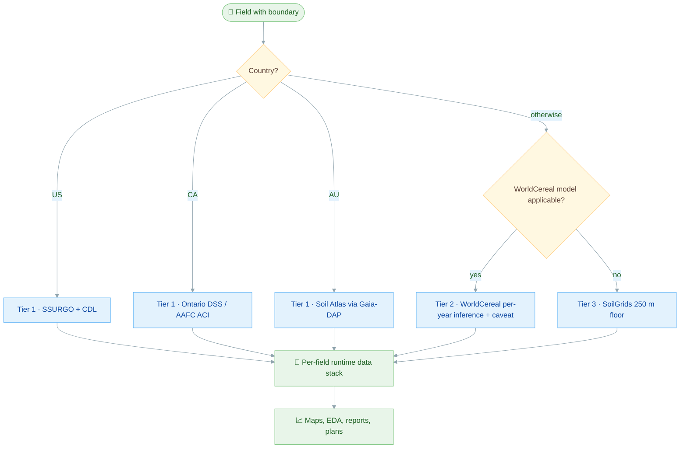

## Runtime and output rules

| Rule | Why |
| --- | --- |
| Runtime data lives outside Git, under `${DATA_PIPELINE_DATA_ROOT}` (default `./data`) | Farm data grows roughly linearly with monitored acreage — the clone must stay small for any deployment |
| Generated outputs are committed at exactly one place: `examples/**/output/*.png` | Small deterministic fixtures let examples verify offline; everywhere else, regenerate at runtime (see [`ASSET_POLICY.md`](ASSET_POLICY.md)) |
| Pinned URLs + sha256 journals for downloads | Checksum drift fails closed; a run is reproducible months later |
| Commit metadata and source records, not payloads | Provenance without repository bloat |
| Run `./scripts/validate.sh` after structural changes | Catches missing routers, stale links, and policy regressions |


## Strategy playbooks — the interpretation layer over the raw data

Data without context is a liability. The strategy sub-skill
([`strategy/INDEX.md`](my-farm-advisor/strategy/INDEX.md)) ships
**crop-specific, region-specific, year-stamped playbooks** — currently
2026-season guides for corn, soybean, cotton, wheat, and grain sorghum, each
with regional decision bands, planning windows, maturity frames, risk
watchouts, and citations to extension/economics sources (farmdoc, ISU AgDM,
Crop Protection Network…). A small recommendation engine
(`generate_farm_recommendations` / `generate_field_recommendations`) feeds
those guides with *your measured field attributes* — soil pH, water-holding,
drainage class, erosion risk, rotation history, GDD — into the farm and field
reports, under a hard rule: never invent field facts the data doesn't carry;
say "scout this" instead.

This is an explicitly growing layer: the goal is playbooks for more regions,
more crops, every year — so your agent can tell you what the raw data *means*
for your location and operation, not just plot it. Playbooks are Markdown by
design: fork the format, write yours for your ground, and the same engine
consumes them.

## Your own boundaries are the seed of everything

The field-boundary layers above (CSB, OSM) are **starting material**: great for
experimenting, benchmarking, and coverage demos, and honestly useful for some
tasks even for real operations. But if you farm or trial ground, the pipeline
was built to run against *your* polygons:

1. Drop your field boundaries in — shapefile, KML/KMZ, GeoPackage, GeoJSON,
   Google-Earth export, whatever fell off the cab monitor. Any format works
   because the agent converts it; the pipeline canonical form is per-field
   boundary GeoJSON in WGS84.
2. Tell the agent: *"initialize the data pipeline against these boundaries."*
3. Everything downstream fills out **in the context of your fields**: FIPS /
   province scoping, SSURGO or SoilGrids soils under each polygon, Copernicus
   and (where mapped) 3DEP terrain, NASA POWER weather at each centroid,
   Sentinel-2/Landsat scenes clipped to the boundary, per-year crop-type
   inference, and the reports and dashboards on top.

Your boundaries stay **yours**: they live in your runtime data root
(`$DATA_PIPELINE_DATA_ROOT`, gitignored) and never need to leave your machine —
the skill author never sees them. That's what makes this a private analytics
base rather than someone else's web app: the published catalog is the
methodology, and your farm folder is the instantiation. For quick exploration
without your own polygons, `bootstrap_farm_from_county.py` samples deterministic
public fields from any county and runs the whole pipeline on them.

## Built to be extended — your crop, your region, your operation

This catalog is a **base**, not a finished product. Every capability is a
pattern with a seam: the country-aware soil router takes the provider you
write for your province or parish; the maturity machinery takes the phenology
model for the crop you actually grow; the design library takes your plot
constraints; the reporting templates take the metrics your organization buys.
The three per-domain playbooks in
[`data-pipeline/references/`](my-farm-advisor/data-pipeline/references/)
(boundaries, rotation, soil) document exactly how a new country or provider
gets onboarded — discover, license-check, ingest module, provenance, validator.

Illustrative examples — not a checklist — of what different operators do with
the base, all of it decision support grounded in their own data:

| Reader | Might extend it for |
| --- | --- |
| Grower / farm manager | Field-by-field decision support on their own ground: planting windows, drainage and erosion calls, rotation planning, scouting priorities |
| Grain buyer / processor | Supply-origin risk: contract-area delivery planning, quality and acreage signals near each intake point |
| Insurance / investment | Field-level risk selection and index products, claims triage with damage-evidence imagery, region benchmarks |
| Extension agent | Local variety-trial analytics and advisory dashboards for the counties they serve |
| Research / breeding company | Their trial designs and germplasm pipelines wired to real field conditions |
| Seed company | Maturity models and placement zones for their genetics specifically |

The point of publishing it as skills rather than an application: the analysis
interface is natural language ("show me last week's canopy for the home field"),
the reproducibility layer is scripts + provenance, and anyone — farmer or
geneticist — gets both without us choosing their agent harness for them.

## The three skills in detail

### 🌾 My Farm Advisor

| Area | Index | Examples of work |
| --- | --- | --- |
| Admin | [`admin/INDEX.md`](my-farm-advisor/admin/INDEX.md) | Geoadmin workflows and interactive maps |
| Data sources | [`data-sources/INDEX.md`](my-farm-advisor/data-sources/INDEX.md) | Data rebuilds, deterministic pipeline runs, intelligence reporting |
| EDA | [`eda/INDEX.md`](my-farm-advisor/eda/INDEX.md) | Exploration, comparisons, correlations, visualization, time series |
| Field management | [`field-management/INDEX.md`](my-farm-advisor/field-management/INDEX.md) | Boundaries, CSB sampling, headlands |
| Imagery | [`imagery/INDEX.md`](my-farm-advisor/imagery/INDEX.md) | Landsat and Sentinel-2 workflows |
| Soil | [`soil/INDEX.md`](my-farm-advisor/soil/INDEX.md) | SSURGO, CDL, country routing, poster cards |
| Strategy | [`strategy/INDEX.md`](my-farm-advisor/strategy/INDEX.md) | Crop strategy and maturity planning |
| Weather | [`weather/INDEX.md`](my-farm-advisor/weather/INDEX.md) | NASA POWER weather and derived analysis |
| Data pipeline | [`data-pipeline/README.md`](my-farm-advisor/data-pipeline/README.md) | Country-aware ingest, per-field rendering, runtime management |

### 🌱 My Farm Breeding Trial Management

| Area | Examples of work |
| --- | --- |
| Design | RCBD, alpha-lattice, augmented designs (with committed layout fixtures) |
| Fieldbook | Plot sheets, labels, imports, IoT field sync |
| Placement | Field-boundary-aware trial siting |
| Germplasm | Accessions, pedigrees, mock breeding-system integrations |
| Selection | Selection indexes, GEBV ranking, cycle simulation |
| Crossing | Mate pairing, coancestry-aware crossing plans |

### 🧬 My Farm QTL Analysis

| Area | Examples of work |
| --- | --- |
| Mapping | GWAS (GLM/LMM), eQTL, classical QTL, GxE, covariates, rare variants |
| QC | VCF validation, SNP filtering, genomic control, imputation |
| Structure | PCA, admixture, LD decay, haplotypes, kinship |
| Prediction | Genomic prediction, BLUP, Bayesian GP, elastic net, cross-validation |
| Reporting | Ideograms, analysis reports, real-dataset packaging |

## Repository layout

```text
my-farm-advisor-skills/
├── README.md, AGENTS.md, ASSET_POLICY.md, CONTRIBUTING.md
├── scripts/validate.sh
├── my-farm-advisor/                 # SKILL.md, INDEX.md, AGENTS.md, workflow areas,
│                                    # data-pipeline (ingest scripts + example fixtures)
├── my-farm-breeding-trial-management/
└── my-farm-qtl-analysis/
```

## Working in this repo

| Task | Start here | Validate with |
| --- | --- | --- |
| Route a farm advisory request | [`my-farm-advisor/SKILL.md`](my-farm-advisor/SKILL.md) | `./scripts/validate.sh` |
| Route a breeding request | [`my-farm-breeding-trial-management/SKILL.md`](my-farm-breeding-trial-management/SKILL.md) | `./scripts/validate.sh` |
| Route a QTL request | [`my-farm-qtl-analysis/SKILL.md`](my-farm-qtl-analysis/SKILL.md) | `./scripts/validate.sh` |
| Add/refresh an example figure | The example's own README | Render, inspect, commit to `examples/**/output/` |
| Change catalog structure | Root [`AGENTS.md`](AGENTS.md) | `bash -n scripts/validate.sh && ./scripts/validate.sh` |
| Update docs with a feature change | [`CONTRIBUTING.md`](CONTRIBUTING.md) (doc-sync rule) | `./scripts/validate.sh` |

Keep edits focused, keep operational data in the runtime root, and route
through the nearest `INDEX.md` before opening detailed workflow docs.
